# АЛЬБИОН. Мониторинг экранов — обзор проекта

Полное описание системы: интерфейсы, логика, API, модель данных. Скомпоновано
по состоянию ветки `feature/postgres-core` (октябрь 2026).

- Интерактивная документация API приложения: `GET /docs` (Swagger UI) на
  работающем сервере.
- Смежные документы: [`TECHNICAL_DESCRIPTION.md`](../TECHNICAL_DESCRIPTION.md),
  [`POSTGRES.md`](../POSTGRES.md), [`DEPLOYMENT.md`](../DEPLOYMENT.md),
  [`ADMIN_GUIDE.md`](ADMIN_GUIDE.md), [`CHANGELOG.md`](../CHANGELOG.md).

## 1. Что это

Внутренний веб-сервис для мониторинга рекламных экранов и координации работ
между командами. Монолит FastAPI + Jinja2 + vanilla JS. Две СУБД на выбор:
PostgreSQL (целевая, изоляция юрлиц через RLS) и SQLite (разработка/откат).

Ключевые подсистемы:

- **Сессии и аудит.** JWT привязан к серверной сессии; отзыв по выходу, смене
  пароля или блокировке пользователя действует немедленно. Все значимые
  действия пишутся в `audit_log`.
- **Юрлица.** Несколько организаций в одной установке, активное юрлицо — часть
  сессии, данные изолированы RLS, общие адреса видны всем.
- **Конструктор ролей.** Роль = возможности + рабочее место + область данных.
- **Типы заданий** с настраиваемыми дополнительными полями.
- **Права переходов workflow** — какие роли продвигают задание по статусам.

## 2. Интерфейсы

### Вход

Форма входа по логину и паролю; после входа пользователь попадает на страницу
своего рабочего места (у каждой роли — своя).

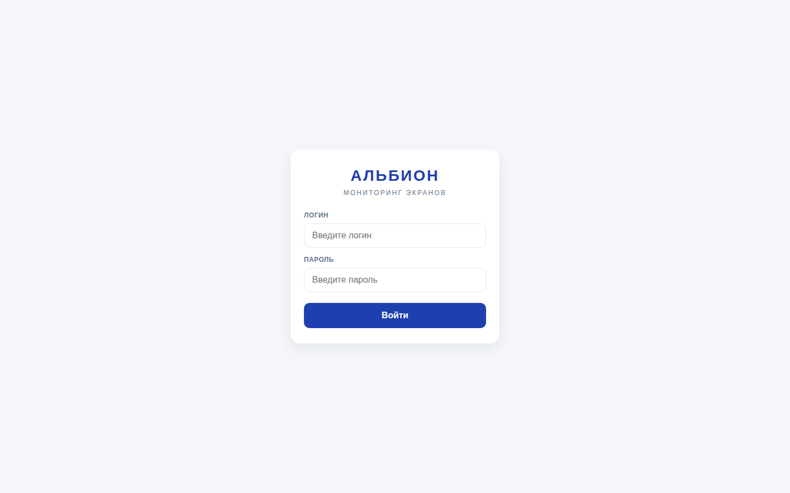

### Лента администратора

Админ видит задания и мониторинги с фильтрами по городу/адресу, статистикой и
быстрыми действиями (принять ✅, отклонить ✕, скрыть). Важные задания
помечаются звёздой, приоритетные подсвечены цветной рамкой. В шапке — «Дать
задание», «Настройки», переключатель юрлица.

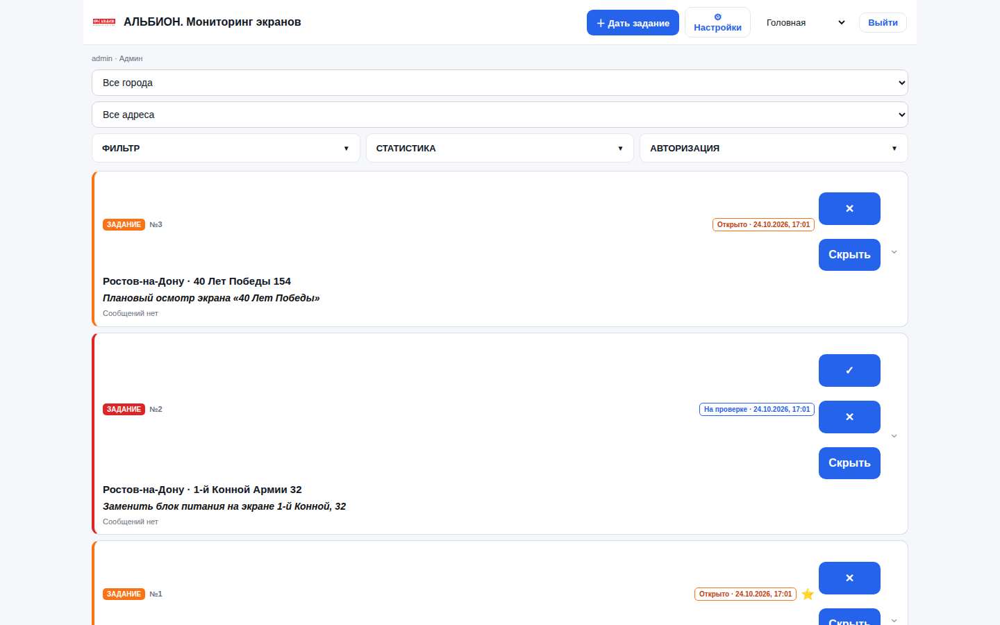

### Конструктор юрлиц

Настройки → «Юрлица группы»: создание, переименование, выключение. Счётчики
показывают объём привязанных данных; удаление юрлиц не предусмотрено —
история сохраняется.

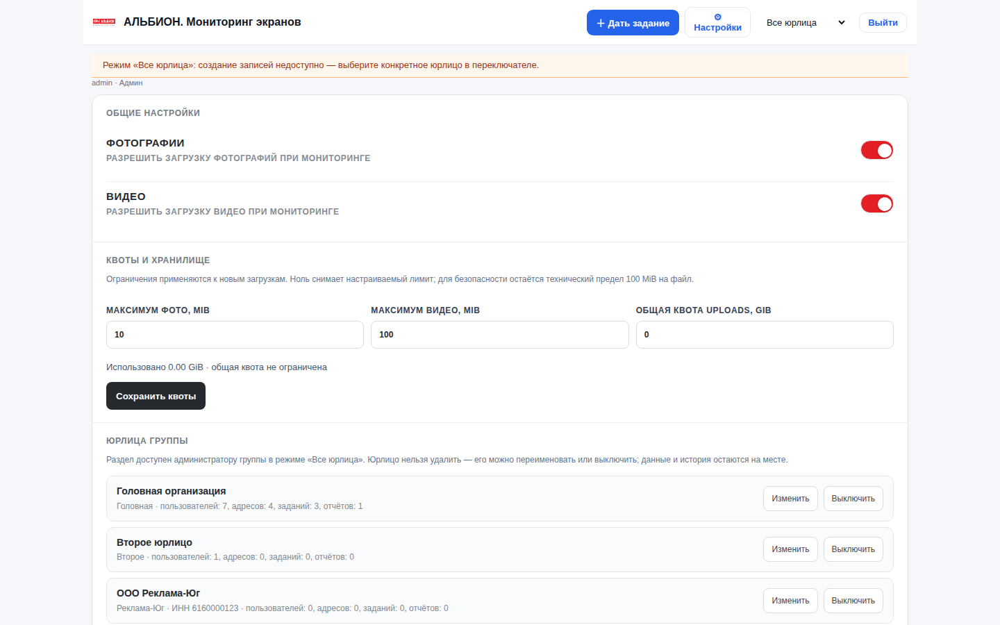

### Конструктор ролей

Настройки → «Роли и возможности»: роль — это возможности (галочки), рабочее
место (страница) и область данных. Системные роли помечены значком и защищены
от правок; любую можно скопировать и донастроить.

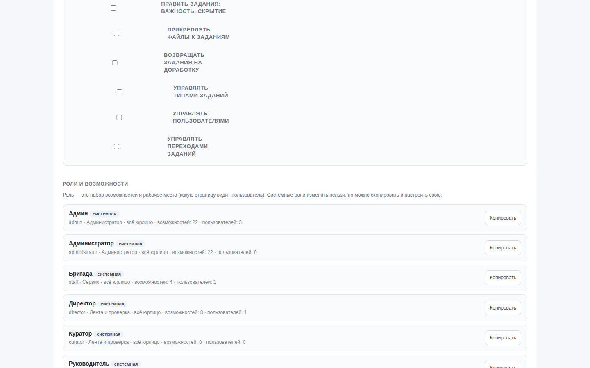

### Типы заданий

Настройки → «Типы заданий»: до пяти дополнительных полей (текст, число, дата,
список) с обязательностью. У используемого типа состав полей не меняется.

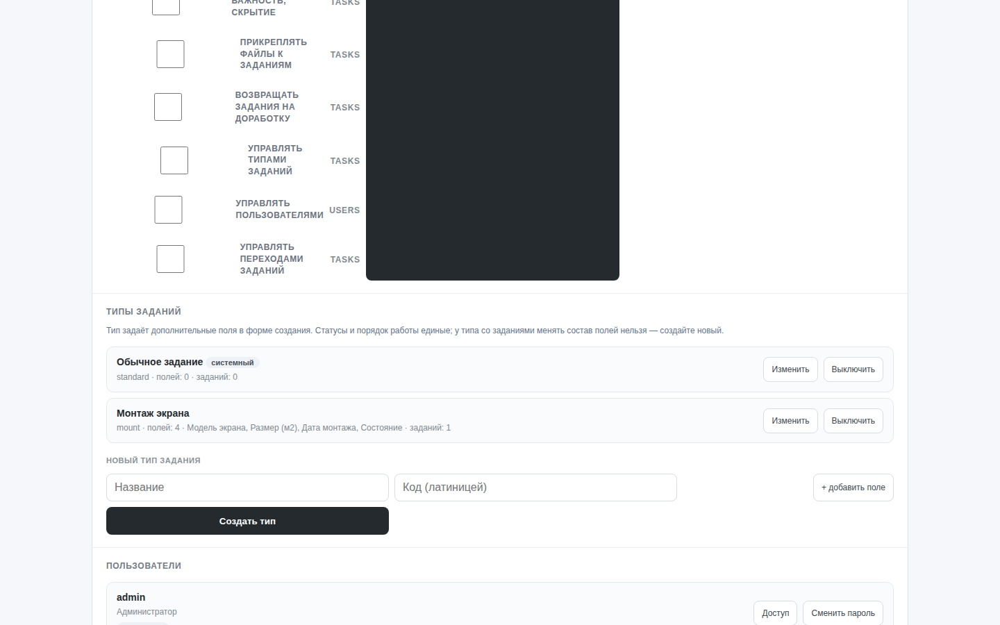

### Права переходов

Настройки → «Переходы заданий»: для каждого перехода отмечаются возможности,
любой из которых достаточно, чтобы его выполнить. Изменения применяются
сразу.

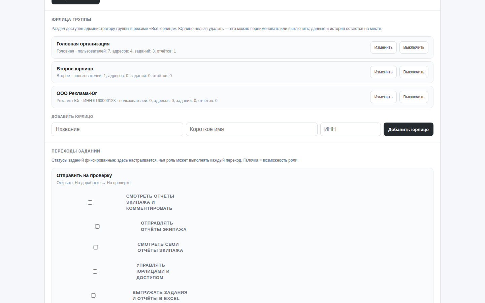

### Создание задания

В модалке создания выбираются город → адрес, тип задания и его поля
(обязательные помечены), описание, важность и вложения.

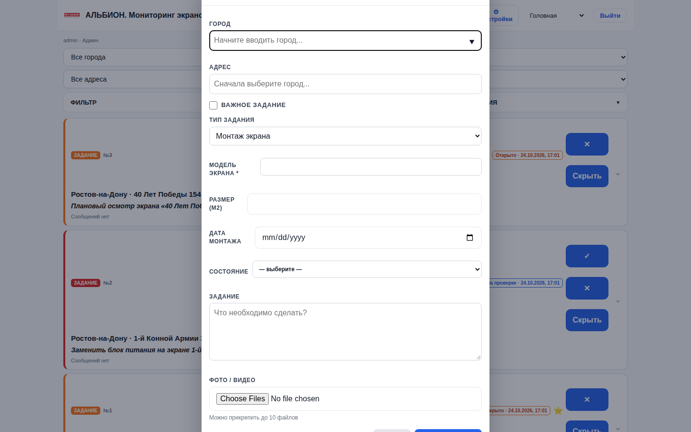

### Лента директора

Директор видит задания и мониторинги, проверяет задания, пишет директорские
комментарии — вместо обычных сообщений.

### Переключатель юрлица

Селект в шапке: сводный режим «Все юрлица» (для администратора группы) или
конкретная организация. После переключения страница перезагружает данные уже
в выбранной области.

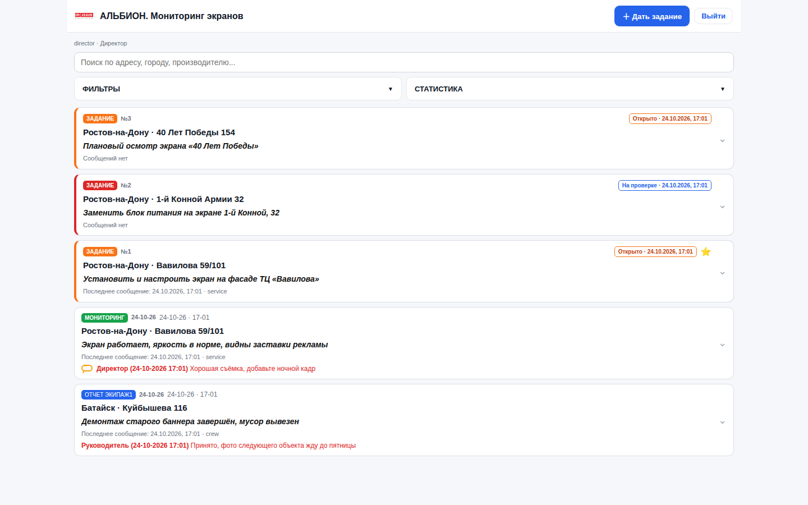

### Сервис (профиль Бригада)

Страница исполнителя: мониторинг адресов, работа с назначенными заданиями,
отправка на проверку.

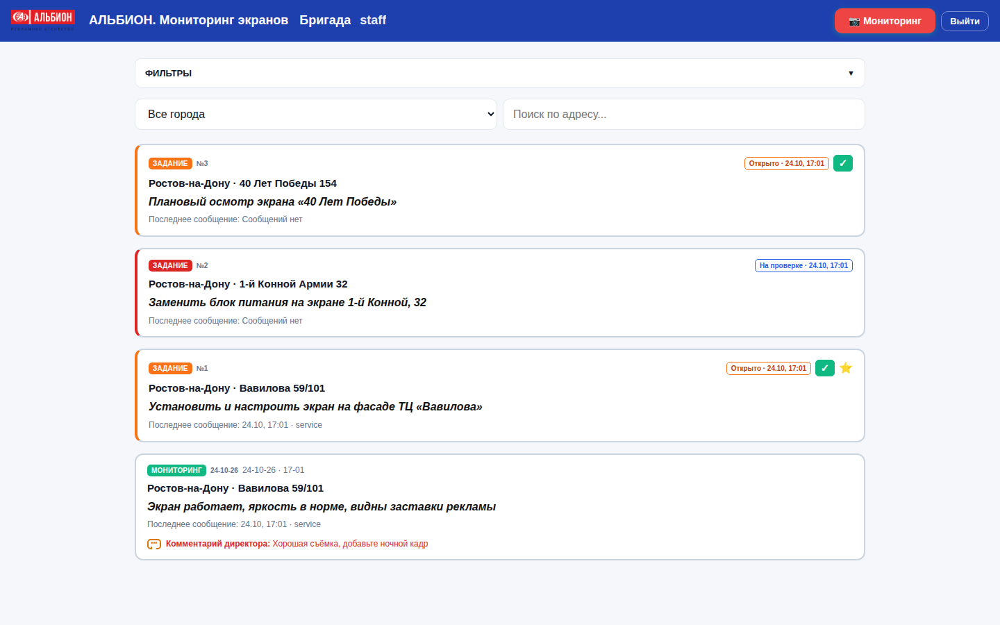

### Экипаж и Руководитель

Экипаж отправляет отчёты по адресам; Руководитель их просматривает и
комментирует.

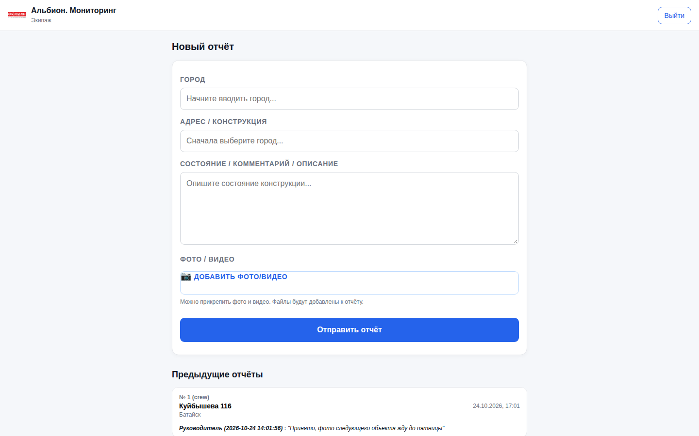

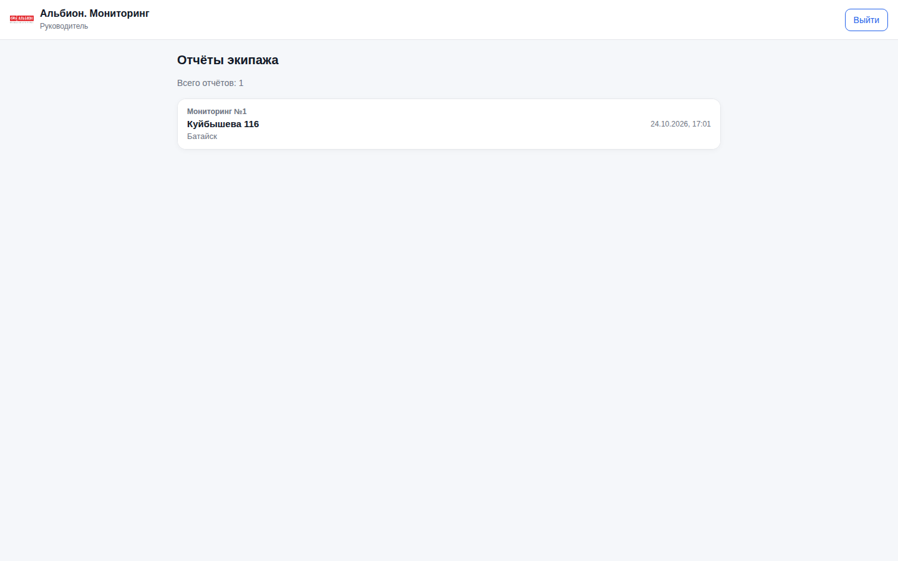

## 3. Логика работы

### Сессии и доступ

1. `POST /api/login` проверяет bcrypt-хэш, создаёт строку `auth_sessions`
   (срок жизни 7 дней, IP), выпускает JWT c `session_id`, `token_version`,
   `legal_entity_id` и сохраняет SHA-256 отпечаток токена.
2. На каждый запрос `auth.get_current_user()` проверяет: сессию (не отозвана,
   не закрыта, не истекла), пользователя (активен), версию прав и отпечаток
   токена. Роль, активность и юрлицо читаются из БД, поэтому понижение роли,
   блокировка и смена пароля действуют без перевыпуска токена.
3. Возможности роли загружаются БД; проверки эндпоинтов выполняются через
   `require_capability()` / `ensure_capability()`.
4. Все значимые действия — в `audit_log` через SAVEPOINT (ошибка аудита
   не откатывает транзакцию).

### Юрлица и изоляция

- Доступные пользователю юрлица = членство (`user_entities`) + собственное
  юрлицо; групповой администратор дополнительно видит все активные.
- Активное юрлицо хранится на серверной сессии. Режим «Все юрлица» доступен
  только групповому администратору; в нём создание записей запрещено, а
  проверки/комментарии разрешены (они наследуют юрлицо объекта).
- В PostgreSQL контекст (список юрлиц + признак группового админа)
  выставляется на каждое соединение (`SET ROLE albion_app`,
  `SET app.legal_entity_ids`), и RLS-политики изолируют данные даже при
  прямом SQL через приложение.

### Роли

- Роль хранится в `roles` (код, название, рабочее место, область данных,
  признак системной) и в `role_capabilities`.
- Эффективная роль пользователя — в активном юрлице (`user_entities.role`),
  иначе `users.role`.
- **Рабочее место** определяет страницу: `admin` → `/administrator`,
  `service` → `/staff`, `director` → `/curator`, `crew` → `/crew`,
  `head` → `/head`.
- **Область данных** `own` сужает ленты и списки собственными записями
  (`AND author = текущий пользователь`).

### Workflow

Статусы фиксированы: `open → pending_review → completed / rework → closed`.
Для каждого перехода (`complete`, `approve`, `rework`, `close`) в
`workflow_transitions` хранится список возможностей: достаточно любой.
Пустой список запрещён; неизвестные возможности отфильтровываются, при полном
рассинхроне работает значение по умолчанию.

### Типы заданий

Тип (`task_types`) содержит схему полей (до 5: текст, число, дата, список с
вариантами). Значения хранятся в `tasks.extra_fields` (JSONB/JSON) и
валидируются при создании: обязательность, число корректное, дата в формате
`ГГГГ-ММ-ДД`, значение списка — из вариантов. У типа с использованными
заданиями состав полей неизменяем.

### Медиа

Загрузка: `POST /api/upload` (multipart) — расширение/тип/размер проверяются,
файл получает временный ключ `temp_*`. Привязка: `POST /api/tasks/{id}/media`
или выгрузка отчёта переименовывает ключ в постоянный. Выдача — только
`GET /api/media/{filename}` после Bearer-проверки, ответы `private, no-store`.
Опционально новые файлы пишутся в `PRIVATE_MEDIA_DIR` (private root, префикс
`pvt_`); квоты (`uploads_quota_bytes`) считаются по обоим корням.

## 4. Справочник API

Авторизация: заголовок `Authorization: Bearer <JWT>`. Возможность в таблице —
минимальное право; «сессия» = любой авторизованный пользователь. Тела — JSON.

### Сессии и профиль

| Метод | Путь | Доступ | Назначение |
|---|---|---|---|
| POST | `/api/login` | публичный | Вход: `{login, password}` → токен, роль, рабочее место, `home` |
| POST | `/api/logout` | сессия | Закрыть свою сессию |
| GET | `/api/me` | сессия | Профиль: роль, рабочее место, возможности, юрлицо, режим |
| GET | `/api/login-users` | публичный | Логины и роли для формы входа (без паролей) |
| GET | `/api/auth-sessions` | users.manage | Список сессий и число активных |
| GET | `/healthz` | публичный | Health-check |

### Юрлица

| Метод | Путь | Доступ | Назначение |
|---|---|---|---|
| GET | `/api/legal-entities` | сессия | Доступные юрлица и текущий выбор |
| POST | `/api/session/legal-entity` | сессия | Переключить юрлицо (`{legal_entity_id}` или `{legal_entity_id: null}`) |
| GET | `/api/admin/legal-entities` | entities.manage + сводный режим | Список со счётчиками данных |
| POST | `/api/admin/legal-entities` | entities.manage + сводный режим | Создать юрлицо |
| PUT | `/api/admin/legal-entities/{id}` | entities.manage + сводный режим | Переименовать / включить / выключить |

### Роли

| Метод | Путь | Доступ | Назначение |
|---|---|---|---|
| GET | `/api/admin/roles` | roles.manage | Роли + каталог возможностей + рабочие места/области |
| POST | `/api/admin/roles` | roles.manage | Создать роль |
| PUT | `/api/admin/roles/{id}` | roles.manage | Изменить роль (системные защищены) |

### Пользователи

| Метод | Путь | Доступ | Назначение |
|---|---|---|---|
| GET | `/api/users` | users.manage | Пользователи в области видимости |
| POST | `/api/users` | users.manage | Создать (логин, пароль, роль, юрлицо) |
| PUT | `/api/users/{id}/password` | users.manage | Сменить пароль (отзывает сессии) |
| GET | `/api/admin/users` | users.manage + сводный режим | Пользователи с членством по юрлицам |
| PUT | `/api/admin/users/{id}/entities` | users.manage + сводный режим | Юрлица, роль и основное юрлицо пользователя |

### Задания и workflow

| Метод | Путь | Доступ | Назначение |
|---|---|---|---|
| POST | `/api/tasks` | task.create | Создать (адрес, описание, тип, `extra_fields`, важность) |
| GET | `/api/tasks` | сессия | Список (`status`, `city`, `manufacturer`, `task_type_id`); область данных учитывается |
| PATCH | `/api/tasks/{id}` | task.manage | Правка (важность, описание и т.д.) |
| DELETE | `/api/tasks/{id}` | task.manage | Совместимость: помечает скрытым |
| POST | `/api/tasks/{id}/media` | task.media | Привязать загруженные файлы |
| POST | `/api/tasks/{id}/complete` | права перехода `complete` | Отправить на проверку |
| POST | `/api/tasks/{id}/approve` | права перехода `approve` | Принять |
| POST | `/api/tasks/{id}/rework` | права перехода `rework` | Вернуть на доработку |
| POST | `/api/tasks/{id}/close` | права перехода `close` | Закрыть (с комментарием) |
| GET | `/api/tasks/{id}/status-history` | сессия | История переходов |
| GET | `/api/tasks/{id}/comments` | сессия | Сообщения и директорские комментарии к заданию |
| POST | `/api/comments` | task.comment | Сообщение в задании |
| GET | `/api/admin/workflow` | workflow.manage | Переходы и настроенные права |
| PUT | `/api/admin/workflow/{code}` | workflow.manage | Права перехода (список возможностей) |

### Мониторинг и ленты

| Метод | Путь | Доступ | Назначение |
|---|---|---|---|
| POST | `/api/reports` | monitoring.send | Мониторинг по адресу (в т.ч. по заданию) |
| GET | `/api/reports` | monitoring.view | Список мониторингов с фильтрами |
| POST | `/api/monitoring` | по ветке | Комментарий (для «лента и проверка») или мониторинг (для «сервис») |
| GET | `/api/monitoring/{address_id}` | сессия | Переписка по адресу |
| GET | `/api/feed` | сессия | Единая лента (`limit`, `offset`) |
| GET | `/api/director/feed` | сессия | Директорская лента |
| POST | `/api/director/comments` | monitoring.comment | Директорский комментарий к заданию/мониторингу |
| POST | `/api/feed/{type}/{id}/hide` | feed.hide | Скрыть карточку ленты |

### Отчёты Экипажа

| Метод | Путь | Доступ | Назначение |
|---|---|---|---|
| POST | `/api/crew/reports` | crew.report.send | Отчёт Экипажа |
| GET | `/api/crew/reports` | crew.report.view | Свои отчёты |
| GET | `/api/head/reports` | crew.report.moderate | Отчёты для Руководителя |
| GET | `/api/head/reports/{id}/comments` | crew.report.moderate | Комментарии к отчёту |
| POST | `/api/head/reports/{id}/comments` | crew.report.moderate | Комментарий Руководителя |

### Медиа, экспорт, справочники

| Метод | Путь | Доступ | Назначение |
|---|---|---|---|
| POST | `/api/upload` | сессия | Временная загрузка файла |
| GET | `/api/media/{filename}` | сессия | Выдача файла (поток, `no-store`) |
| GET | `/api/export/excel` | export.excel | XLSX: задания (+тип и доп. поля) и мониторинги; фильтры `date_from`, `date_to`, `city`, `manufacturer` |
| GET | `/api/cities`, `/api/manufacturers` | сессия | Справочники юрлица |
| GET | `/api/addresses` | сессия | Адреса юрлица (+общие), фильтры `city`, `manufacturer`, `q` |
| GET | `/api/task-types` | сессия | Активные типы заданий со схемами полей |
| GET | `/api/settings` | сессия | Флаги фото/видео и квоты |
| PUT | `/api/settings` | settings.manage | Флаг фото/видео |
| PUT | `/api/settings/quotas` | settings.manage | Лимиты файлов и квота хранилища |

### Типы заданий (админ)

| Метод | Путь | Доступ | Назначение |
|---|---|---|---|
| GET | `/api/admin/task-types` | task_types.manage | Типы с полными схемами и счётчиком заданий |
| POST | `/api/admin/task-types` | task_types.manage | Создать тип |
| PUT | `/api/admin/task-types/{id}` | task_types.manage | Название / вкл-выкл (состав полей — только у неиспользуемых) |

## 5. Ключевые функции кода

### `app/app.py`

| Функция | Что делает |
|---|---|
| `write_audit()` | Пишет действие в `audit_log` через SAVEPOINT: неудача аудита не откатывает транзакцию и логируется |
| `client_ip()` | Достаёт и валидирует IP (колонка `inet`) |
| `require_group_scope_manager()` | Гейт разделов группы: сводный режим + роль администратора |
| `load_role_checked()` | Проверяет, что роль существует и активна |
| `user_in_scope()` | Доступен ли пользователь admin в его области |
| `user_entity_options()` / `can_view_all_entities()` | Опции юрлиц и доступность сводного режима |
| `parent_entity_id()` / `scope_entity_for_reply()` | Юрлицо записи, привязанной к объекту |
| `own_scope_clause()` | SQL-фрагмент области «только свои» |
| `task_type_schemas()` / `format_extra_fields()` | Схемы полей типов и форматирование для карточек |
| `parse_extra_fields()` | Валидация значений полей при создании задания |
| `load_workflow_permissions()` / `ensure_transition_allowed()` | Права переходов и проверка |
| `roles_with_capabilities()` / `validate_role_payload()` | Выдача и валидация ролей |
| `get_task_for_workflow()` / `add_task_status_history()` / `set_task_workflow_status()` | Чтение задачи, история, смена статуса |
| `enforce_director_task_scope()` | Директор проверяет только задания, созданные директорами |
| `compress_image()` / `upload_media()` / `media_path_for_key()` | Обработка и хранение медиа |
| `get_unified_feed()` / `director_feed()` | Ленты |
| `export_excel()` | XLSX-выгрузка |

### `app/auth.py`

| Функция | Что делает |
|---|---|
| `create_token()` / `decode_token()` / `token_fingerprint()` | JWT и привязка к сессии |
| `load_role()` | Роль из БД: рабочее место, область, возможности |
| `role_code_for_entity()` | Роль пользователя в активном юрлице |
| `available_entities()` | Юрлица, доступные пользователю |
| `get_current_user()` | Полная проверка запроса (сессия, пользователь, роль) + контекст |
| `user_has()` / `ensure_capability()` / `require_capability()` / `require_capabilities()` | Проверки возможностей |
| `require_entity_scope()` | Юрлицо для создания записи |
| `require_role()` / `require_any()` | Совместимость (роль/базовая роль) |

### `app/database.py`

| Функция | Что делает |
|---|---|
| `get_db()` | Соединение (PostgreSQL через SQLAlchemy + psycopg, SQLite) |
| `set_tenant_context()` / `apply_tenant_settings()` / `tenant_entity_ids()` | Контекст юрлиц для RLS |
| `sync_permissions()` / `sync_task_types()` / `sync_workflow_transitions()` | Синхронизация каталога и системных значений из кода |
| `_migration_1..8()` | Версионные SQLite-миграции |
| `_PgConnection.execute()` | Адаптер SQLite-синтаксиса (`?`, `lastrowid`) в psycopg |

### `app/permissions.py`

Каталог `CAPABILITIES` (код → домен + описание), системные роли `SYSTEM_ROLES`
(возможности, рабочее место, область), реестр `WORKFLOW_TRANSITIONS`,
хелперы `capability_catalog()`, `home_for()`, `normalize_workplace()`.

### `app/migrate_sqlite_to_pg.py`

Перенос SQLite → PostgreSQL: читает SQLite в режиме `ro`, пишет одной
транзакцией, сохраняет id, конвертирует время в timestamptz (UTC),
`media_json` — в jsonb, выставляет identity-последовательности, отказывается
писать в непустую БД без `--truncate`.

## 6. Модель данных

| Таблица | Назначение |
|---|---|
| `users` | Пользователи: роль-фолбэк, активность, `token_version`, юрлицо |
| `auth_sessions` / `core.sessions` | Сессии: `token_hash`, срок, отзыв, активное юрлицо, режим |
| `legal_entities` / `core.legal_entities` | Юрлица группы |
| `user_entities` / `core.user_entities` | Членство: юрлицо, роль, основное |
| `roles`, `capabilities`, `role_capabilities` | Конструктор ролей |
| `workflow_transitions` | Права переходов |
| `task_types` | Типы заданий и схемы полей |
| `domains` | Домены (слои) приложения |
| `addresses` / `monitoring.addresses` | Адреса: юрлицо + `shared` |
| `tasks` / `monitoring.tasks` | Задания: статус, workflow, тип, `extra_fields`, юрлицо |
| `task_status_history` | История переходов |
| `comments`, `director_comments` | Сообщения заданий и директорские комментарии |
| `reports` / `monitoring.reports` | Мониторинги сервиса |
| `crew_monitorings`, `crew_monitoring_media` | Отчёты Экипажа (+ медиа) |
| `crew_report_comments`, `crew_report_comment_media` | Комментарии Руководителя (+ медиа) |
| `media` / `monitoring.media` | Медиа-связи (файлы на диске, ссылки в БД) |
| `settings` | Настройки: флаги, лимиты, квоты |
| `audit_log` / `core.audit_log` | Журнал действий |

Полная PostgreSQL-схема (FK, индексы, RLS-политики, функции) — в
[`POSTGRES.md`](../POSTGRES.md) и `app/migrations/`.

## 7. Проверки

- **93** юнит/интеграционных теста: SQLite + PostgreSQL (pgserver), включают
  полный ролевой прогон приложения на PostgreSQL, RLS-изоляцию двух юрлиц,
  отзывы сессий, аудит, конструктор ролей, типы заданий и переходы.
- **37/37** Playwright-сценариев: входы всех ролей, задания/проверки/доработка,
  мониторинг, отчёты Экипажа, настройки администратора, переключение юрлица,
  конструктор ролей, типы заданий, workflow.
- **Репетиции миграций** на копиях рабочей базы: сверка количества строк и
  контрольных сумм, ссылочная целостность, идемпотентность.
